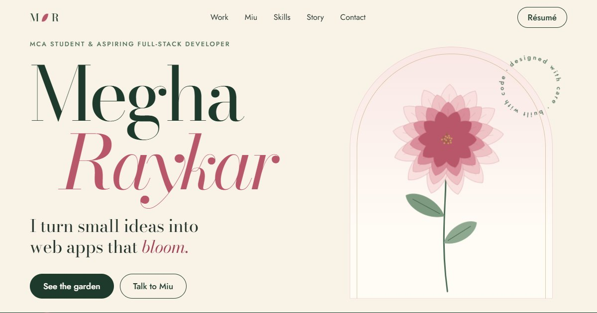

# Megha Raykar

My portfolio: **[megharaykar27.github.io](https://megharaykar27.github.io/)**

*I turn small ideas into web apps that bloom.*



## What's inside

- **The garden.** My projects as flower plates. Every flower is drawn with code, and each plate opens a short story: the seed, how it grew, and what's in bloom.
- **Miu, my twin AI.** Visitors can ask about my projects, skills and studies. Miu answers only from my real resume and project notes, shows its sources, and says so when it doesn't know. It runs fully in the browser, with the same engine as [MyTwin](https://github.com/Megharaykar27/MyTwin).
- **Skills that point to proof.** Choose a skill to see the projects it was used in.
- **Motion with care.** A vine that grows as you scroll, a flower that blooms on load, and a ribbon that dances with you. Everything calms down when "reduce motion" is on.

## Built with

Plain HTML, CSS and JavaScript. No frameworks and no build step. Fonts: Bodoni Moda, Jost and Pinyon Script (SIL Open Font License).

## Run it

```bash
npx serve .
```

## Update it

| To change | Edit |
|---|---|
| Projects and skills | `js/content.js` |
| Text on the page | `index.html` |
| Resume | replace `assets/Megha-Raykar-Resume.pdf` |
| What Miu knows | update MyTwin, then run `node tools/sync-miu.mjs` |

© Megha Raykar
